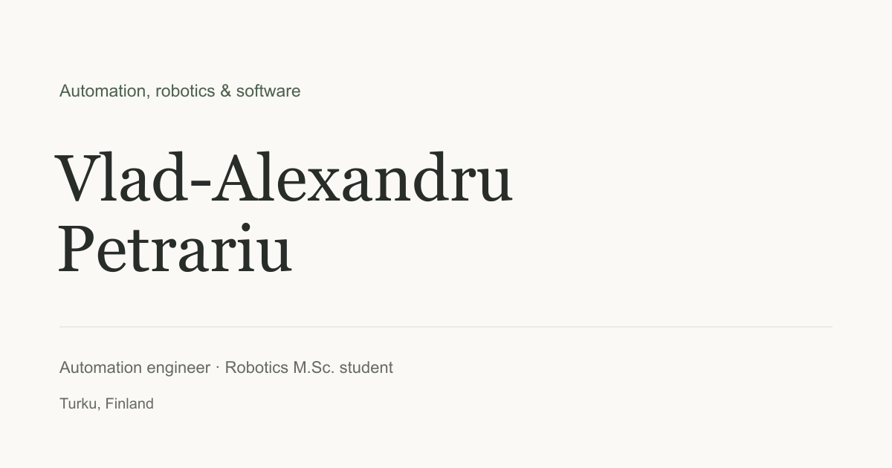

# Vlad Petrariu · Engineering portfolio

A minimal engineering portfolio built with **React, TypeScript, and Vite**. It presents work in automation, robotics, embedded systems, and software, with shareable views for different applications.

[Portfolio](https://vlad-alexandru03.github.io/) · [Tailoring guide](docs/TAILORING.md) · [Deployment workflow](.github/workflows/deploy.yml)



## Run locally

Requires Node.js 22.12+ (Node 24 recommended) and npm.

```sh
npm ci
npm run dev
```

Open the local URL printed by Vite. To validate and preview the production build:

```sh
npm run check
npm run build
npm run preview
```

The production homepage is rendered to HTML at build time so the main portfolio remains readable without JavaScript. React adds discipline selection, share links, and project dialogs. Styling uses CSS; interface icons are from Lucide. DM Sans and IBM Plex Mono are served locally through Fontsource, with system fallbacks.

## Tailor the site without duplicating it

One source of professional facts lives in [`src/content/portfolio.ts`](src/content/portfolio.ts). Profile-specific presentation lives in [`src/content/profiles.json`](src/content/profiles.json).

Built-in views:

- Default: the site root.
- Automation: `?focus=automation`.
- Robotics: `?focus=robotics`.
- Software: `?focus=software`.

Each profile sets a two-line headline, introduction, project order, and skill-group order. Projects can be omitted from a profile by removing their IDs from its order. Their underlying descriptions, education, and experience are shared.

For a specific application, clone a relevant profile:

```sh
npm run tailor -- --id marine-automation --from automation --label "Marine automation"
```

Then edit the new profile in `src/content/profiles.json`, run `npm run check`, review locally at `?profile=marine-automation`, and deploy. Share the live URL ending in that same query. Changes to this file require a rebuild and deployment; the tailoring command does not publish anything itself.

See [the tailoring guide](docs/TAILORING.md) for the recommended routine and alternative approaches.

## Publish free with GitHub Pages

The repository is **Vlad-Alexandru03.github.io**, configured for GitHub Actions deployment to [vlad-alexandru03.github.io](https://vlad-alexandru03.github.io/). Future pushes to `main` rebuild and publish automatically.

To reproduce the setup in another account:

1. Create that **public** repository under `Vlad-Alexandru03`. Keep private CVs and other private files out of the source and Git history.
2. Push this project to its `main` branch.
3. In the repository, go to **Settings → Pages → Build and deployment → Source → GitHub Actions**.
4. Run or rerun **Build and deploy portfolio** under Actions, if necessary.
5. Verify the successful Pages deployment, public URL, project links, and profile query links.

The included workflow installs from the lockfile, validates content and types, builds, and deploys. A pull request runs the checks and build without deploying. It also supports an ordinary project repository by calculating Vite's base path from the repository name.

For manual project-path builds in PowerShell:

```powershell
$env:BASE_PATH = '/personal-site/'
npm run build
Remove-Item Env:BASE_PATH
```

If adding a custom domain later, change the workflow to use `BASE_PATH=/` and configure DNS and HTTPS in Pages settings.

## Project structure

```text
src/
  App.tsx                      Page sections and interactions
  components/EngineeringVisual.tsx  Conceptual SVG illustrations
  content/portfolio.ts         Shared, factual content
  content/profiles.json        Application views
  profiles.ts                 Profile selection and validation
  styles.css                  Responsive layout and print styles
scripts/
  prerender.tsx               Build-time homepage HTML
  validate-content.ts         Content consistency and URL checks
  tailor.mjs                  Clone a profile for an application
.github/workflows/deploy.yml   GitHub Pages checks and deployment
```

## Content and privacy

- The original CV remains private and is not included or linked. Public contact is email only; no phone number is displayed.
- Project descriptions are grounded in the supplied CV. The edge-computing repository was also reviewed. See [content sources](docs/CONTENT_SOURCES.md).
- Research manuscripts are marked as in preparation, not published.
- SVG diagrams are conceptual illustrations, not photographs or recorded experimental results.
- No database, tracking analytics, cookies, accounts, or form service is required. Fonts and illustrations are served locally; loading the site does not require Google Fonts requests.
- All profile definitions are part of the public build. A tailored URL is **not private**. Never put recruiter names, private job descriptions, or confidential material in profiles.

## Maintenance

Update the shared facts first. Tailor emphasis only in profile settings. Run the content check and build before pushing. Review links and dates before important applications. Keep the dependency lockfile committed, and review dependency updates periodically.

The factual content and personal materials belong to their respective owner. No blanket open-source license is applied to the user's biography or project content.
